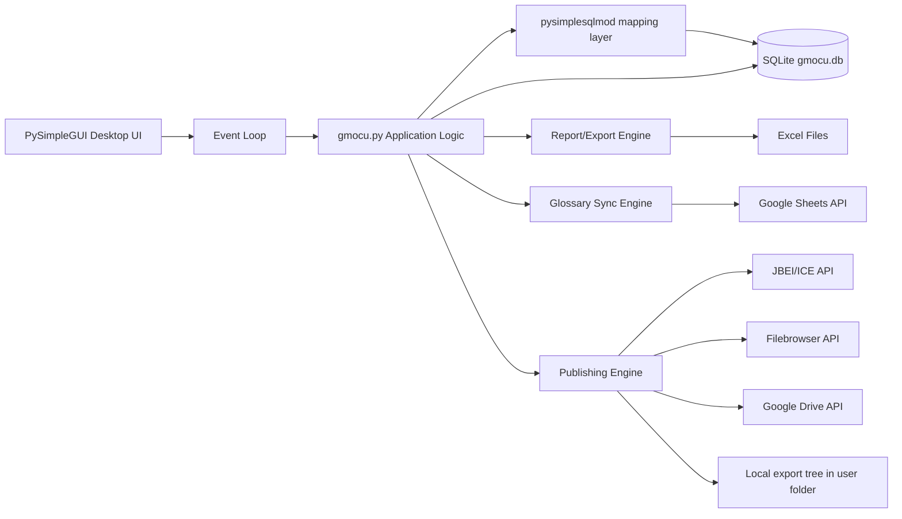
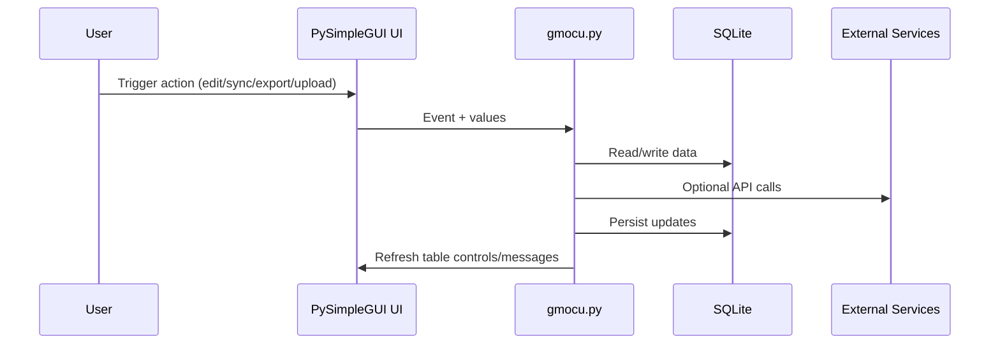
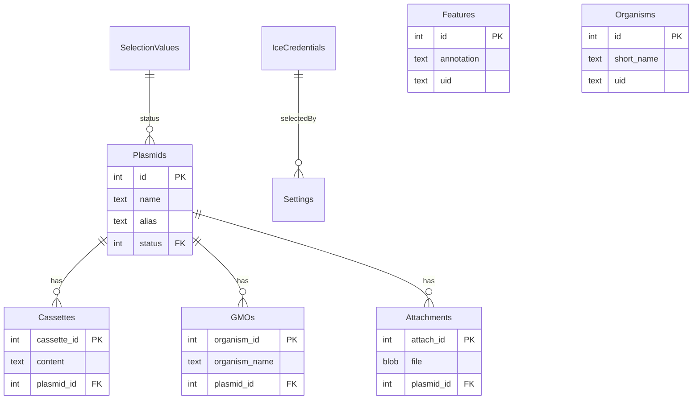

# GMOCU architecture diagram

## 1) Logical component diagram

## 2) Runtime sequence (high level)

## 3) Data model relationship diagram

## 4) Architectural characteristics (current)

- Monolithic application script with integrated UI + domain + integration logic.
- Stateful desktop loop with local SQLite as system of record.
- Partial abstraction over DB through PySimpleSQL-style mapper, mixed with direct SQL.
- Synchronous integration calls from UI thread.
